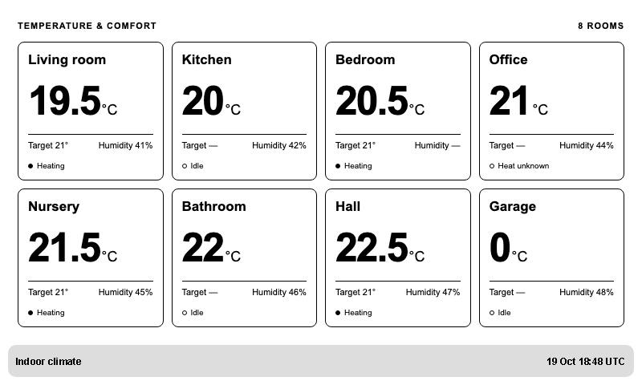
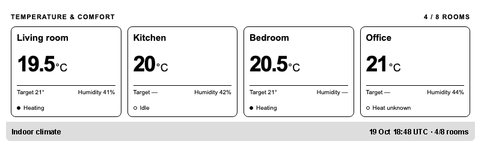
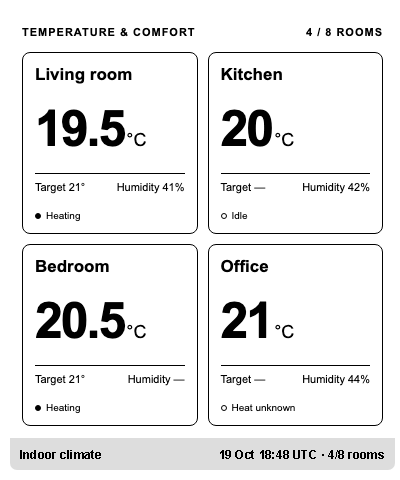
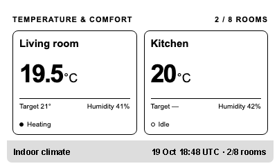

# tado-bridge

A read-only CLI and local service for tado° V3/V3+ and X. It collects indoor-climate readings and exposes a cached JSON API, with optional Prometheus metrics and TRMNL publishing. The collector works independently of any display or dashboard.

## What is available

- Browser-based OAuth login, automatic token refresh, and home/room discovery, including accounts with mixed V3 and X homes.
- One-shot or scheduled collection of temperature, target temperature, humidity and heating activity.
- A local cached API with health/readiness endpoints, request budgeting and bounded retries.
- Optional Prometheus metrics and selected-room publishing to a TRMNL private plugin.
- Local Compose operation, a Helm chart, and GoReleaser builds for binaries and container images.
- Cosign signing configured for release binaries, checksums and container manifests.

## Quick start

To build from source, install the latest stable Go release; the minimum version is declared in [go.mod](go.mod). You also need a tado° account, internet access and a browser for authorization.

```sh
make build
export TADO_CREDENTIALS_FILE="$HOME/.config/tado-bridge/credentials.json"

./bin/tado-bridge auth login
./bin/tado-bridge discover
./bin/tado-bridge read
./bin/tado-bridge serve
```

Login prints a verification URL and user code. Open the **complete URL, including its query parameters**, and authorize in your browser. The CLI waits for approval and never asks for your account password. Keep the URL, code and credentials private.

`discover` returns home and room IDs needed for explicit room selection. X rooms use the same `zones` representation as V3 zones. `read` prints one JSON snapshot and exits; repeated runs consume upstream quota. `serve` collects in the background until Ctrl-C or SIGTERM.

| Command | Purpose |
|---|---|
| `auth login` | Authorize access and save credentials |
| `auth status` | Inspect local credentials and expiry; does not check upstream validity |
| `auth logout` | Delete local credentials; does not revoke upstream access |
| `discover` | Print home and room IDs/names as JSON |
| `read` | Collect and print measurements once |
| `serve` | Run the collector and cached HTTP API |
| `healthcheck` | Check local HTTP liveness without credentials or upstream calls |

Every command supports `--help`. JSON results go to stdout; login instructions, logs and request counts go to stderr. See [authentication](docs/authentication.md) for OAuth details and troubleshooting.

## Local API and readings

With `serve` running, use another terminal:

```sh
curl --fail http://127.0.0.1:8080/healthz
curl --fail http://127.0.0.1:8080/readyz
curl --fail http://127.0.0.1:8080/api/v1/snapshot
```

| Endpoint | Behavior |
|---|---|
| `/api/v1/snapshot` | Latest cached JSON; 503 before the first successful collection |
| `/healthz` | Process liveness, including during upstream outages |
| `/readyz` | 200 when cached climate readings are available and within the configured age limit; otherwise 503 |
| `/metrics` | Optional Prometheus metrics; disabled by default |

API reads never trigger tado° requests. A collection failure preserves the last good snapshot, including its original `collected_at`. The snapshot endpoint can therefore return stale data with HTTP 200; consumers must check timestamps or readiness.

Readings use Celsius and humidity percent. Missing values are `null`; zero and `false` are valid. A room switched off has no active target temperature. Heating activity comes from upstream heating power, and does not prove that a boiler is firing. `collected_at` records collection time; `temperature_measured_at` is populated only when tado° supplies a sensor timestamp, so a successful collection does not guarantee a recent sensor reading.

See [architecture and scheduling](docs/architecture.md) and [metrics](docs/metrics.md) for the full behavior.

## Configuration and request budget

Configuration uses environment variables:

| Variable | Default | Purpose |
|---|---|---|
| `TADO_CREDENTIALS_FILE` | required | Private writable credentials path |
| `LISTEN_ADDR` | `127.0.0.1:8080` | HTTP listener |
| `POLL_INTERVAL` | `30m` | Requested minimum collection delay; at least `5m` |
| `MAX_SNAPSHOT_AGE` | `2h` | Freshness limit for readiness and TRMNL |
| `TADO_DAILY_REQUEST_BUDGET` | `90` | Process-local rolling 24-hour cap on REST and OAuth attempts |
| `API_TOKEN` | unset | Bearer token for snapshots and enabled metrics |
| `ALLOW_NETWORK_EXPOSURE` | `false` | Required with `API_TOKEN` to bind outside loopback |
| `METRICS_ENABLED` | `false` | Enable `/metrics` |

When `API_TOKEN` is set, send `Authorization: Bearer <token>` to the snapshot and metrics endpoints. Health/readiness remain unauthenticated. Keep remote access behind trusted networking and an appropriate authentication/TLS boundary.

The request budget can increase the configured polling interval. One X home needs three REST calls per collection; reserving an OAuth refresh gives an effective **64-minute interval** with the default budget. V3 homes need additional requests per zone, so their collection interval and freshness limit may need adjustment. HTTP 429 honors upstream reset deadlines; transient failures use bounded retries.

The budget counts this service process only. Other clients and CLI commands consume additional quota, and restarting resets local accounting without resetting tado°'s quota. Leave headroom for other integrations.

## Credentials and runtime state

Credentials are stored unencrypted outside the repository, with private directories and mode-0600 files. Refresh-token rotation atomically replaces the file, so the whole credentials directory must be writable. Treat IDs, room names and climate readings as private data too.

Run one instance per credential set. Stop `serve` before running another command against the same file, and do not give copies of its refresh token to another integration. The process holds a credentials lock until shutdown; after a forced termination, confirm that no instance is running before removing a stale lock. See [security](SECURITY.md) for storage and recovery details.

## Containers, Helm and releases

After configuring credentials and `API_TOKEN`, `make compose-up` builds the local image with ko and starts Compose. `make compose-down` stops it. Compose publishes only on host loopback; stop any native instance using the same credentials before starting it. See [container setup](docs/containers.md) for mounts, ownership and settings.

The [Helm chart](charts/tado-bridge/README.md) runs one collector with Recreate updates, an existing writable credentials PVC, existing Secrets and a ClusterIP-only Service. `make helm-check helm-package` validates and packages it without deploying.

`make release-snapshot` builds Linux/macOS amd64/arm64 binaries and local Linux container images without publishing. The separate version-tag workflow publishes binaries, checksums and the multi-platform GHCR image, with native GitHub release notes and keyless cosign signatures. See [release operation and signature verification](docs/releases.md). Tags, releases and deployments require an explicit operator decision.

## TRMNL

TRMNL publishing is disabled by default. Enabling it sends explicitly selected cached room readings, display aliases and timestamps to TRMNL cloud. Configure your private-plugin webhook, `TRMNL_ENABLED=true` and `TRMNL_ROOMS`; the collector and API continue to work when TRMNL is disabled or unavailable.

See [private-plugin setup and device testing](integrations/trmnl/README.md). `make trmnl-package` creates an import ZIP. For an existing plugin, replace its four **Edit Markup** tabs and save; importing again creates another plugin.

The previews below use **synthetic data**, including missing readings and a valid zero. Smaller layouts follow the configured room order and show how many rooms are visible. Stale collections display a warning.

**Full · 800 × 480 · eight rooms**



<table>
  <tr>
    <th>Half horizontal · four rooms</th>
    <th>Half vertical · four rooms</th>
    <th>Quadrant · two rooms</th>
  </tr>
  <tr>
    <td></td>
    <td></td>
    <td></td>
  </tr>
</table>

These are browser renders using TRMNL's stylesheet. Final rendering and refresh behavior should also be checked on your virtual or physical device.

## Scope and future work

The current integration depends on tado° cloud access. It does not provide local Matter support, thermostat controls, a built-in dashboard, historical storage, MQTT or generic outbound webhooks. Additional consumers can use the cached JSON API without changing the collector.

MQTT and other output adapters are possible future extensions, driven by actual needs. Continuous 24-hour testing on an always-on host and acceptance with a physical TRMNL device remain follow-up validation work. The [design document](docs/design/tado-bridge-design.md) retains the architecture and implementation history.

## Development

```sh
make check
```

This runs race tests, vet, lint, vulnerability checks and module verification; golangci-lint v2.15 is required. Tests use synthetic data and local servers, without real tado° credentials. Workflow changes should also pass `actionlint` and `zizmor --persona pedantic .github/workflows .github/dependabot.yml`.

The [packaging integration scripts](scripts/README.md) cover prebuilt images, Compose and chart installation in a disposable Kind cluster. Keep dependencies and build tools current, and verify updates against their official sources.
