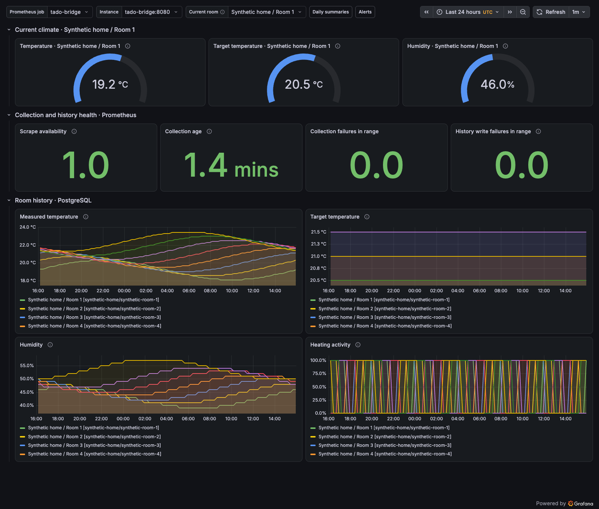

# Grafana dashboard

Import [tado-bridge.json](tado-bridge.json) through **Dashboards → New → Import**, upload the JSON file and select your Prometheus and PostgreSQL data sources. Grafana runs independently of the bridge; the optional Compose overlay can run it locally alongside Prometheus. The PostgreSQL panels require [history](../../docs/history.md) to be enabled and at least one successful collection.

The dashboard includes:

- Current temperature, active target and humidity gauges for the selected room, or an explicitly labeled aggregate mean.
- Prometheus scrape availability, collection age, collection failures and history write failures.
- Historical measured/target temperatures, humidity and heating activity per room from PostgreSQL, grouped by Grafana's time interval.

Select the Prometheus job and instance at the top. The PostgreSQL source should point to the dedicated database/schema used by that same collector; Prometheus selection does not switch databases. The **Current room** combo is populated automatically from cached room metrics. It controls the three top gauges, whose titles identify the selected room. **All rooms (mean)** averages available readings across the cache; historical panels continue comparing all rooms. Missing targets or humidity show **No data**, not an aggregate fallback.

Room discovery requires `METRICS_ROOM_DETAILS=true` alongside `METRICS_ENABLED=true`; no room IDs need to be configured. It uses discovered home/room names, with IDs only to disambiguate duplicate or missing names. Home/room names can be private: the optional observability Compose overlay explicitly enables this setting, while the base service/chart keep it disabled. Without the opt-in, only **All rooms (mean)** is offered. Discovery does not make extra tado requests. Up to 128 rooms per current snapshot are exposed; `tado_bridge_room_details_omitted` reports any overflow. Historical series use the names and IDs already stored in PostgreSQL to distinguish rooms, so keep Grafana and its data source private.

## Optional local Compose stack

Combine `compose.yaml`, `compose.history.yaml` and `compose.observability.yaml` to run the bridge, PostgreSQL, Prometheus and Grafana locally. The default Compose setup remains independent of these services. The overlay enables metrics, provisions both data sources and the dashboard, and creates a dedicated read-only PostgreSQL login for Grafana. Grafana and Prometheus publish only on host loopback; PostgreSQL has no host port.

Stop other instances sharing your OAuth credentials. Keep your existing `TADO_CREDENTIALS_DIR`, `API_TOKEN` and database password. For a new local setup:

```sh
export TADO_BRIDGE_UID="$(id -u)"
export TADO_BRIDGE_GID="$(id -g)"
export OBSERVABILITY_DIR="$HOME/.local/share/tado-bridge-observability"
# Generate these only when creating new state; keep them securely for restarts.
export HISTORY_POSTGRES_PASSWORD="$(openssl rand -hex 24)"
export GRAFANA_DB_PASSWORD="$(openssl rand -hex 24)"
export GRAFANA_ADMIN_PASSWORD="$(openssl rand -hex 24)"

go run ./internal/testutil/cmd/observability prepare "$OBSERVABILITY_DIR"
make image
export COMPOSE_FILE=compose.yaml:compose.history.yaml:compose.observability.yaml

docker compose up -d --wait postgres
docker compose exec -T postgres sh /docker-entrypoint-initdb.d/20-grafana-reader.sh
docker compose up -d --wait
```

First set `TADO_CREDENTIALS_DIR` and `API_TOKEN` as described in [container setup](../../docs/containers.md). The preparation helper copies that token into a mode-0600 file for Prometheus, maps the importable dashboard to stable local data-source UIDs and creates private state directories. The services run with your nonroot host UID/GID so they can access these files without weakening host permissions. It does not read OAuth credentials or overwrite existing Grafana/Prometheus state. Rerun it after API-token or dashboard changes; restart Prometheus after rotating the token.

The PostgreSQL initialization script runs automatically for a new database volume. The explicit `exec` above also handles an existing history volume and can deliberately rotate the read-only role's password. SQL values use psql quoting. Changing `HISTORY_POSTGRES_PASSWORD` or `GRAFANA_ADMIN_PASSWORD` in the environment does not rotate passwords in already initialized PostgreSQL/Grafana state; use their normal administration procedures.

Open [Grafana](http://127.0.0.1:3000/d/tado-bridge) and sign in as `admin` with `GRAFANA_ADMIN_PASSWORD`. The dashboard appears automatically in the **tado-bridge** folder. [Prometheus](http://127.0.0.1:9090) is also available on loopback. Optional `GRAFANA_PORT` and `PROMETHEUS_PORT` change the host ports. Grafana login is required; the Prometheus UI is local and has no separate login.

Prometheus retains 15 days of scrapes. Its TSDB and Grafana's state live under `OBSERVABILITY_DIR`; PostgreSQL history stays in the separate `history-data` named volume. `docker compose down` with the same `COMPOSE_FILE` preserves both. Do not add `--volumes` or remove state directories unless you intend to delete their data. The overlay does not deploy anything, configure public ingress or send metrics to an external service. The default authenticated API and upstream request cadence remain unchanged.

## Screenshot and reproducible preview



This is an actual local Grafana screenshot with **synthetic data**, generated independently of any tado account: 24 hours of readings for eight generic rooms. It is not a screenshot of a user's home. Current data come from the fixture's real Prometheus exporter; history comes from PostgreSQL through the provisioned read-only data source.

To validate the optional stack or regenerate the image:

```sh
make release-snapshot
make observability-smoke
# Keep a validated synthetic stack running for interactive review:
go run ./internal/testutil/cmd/observability smoke --keep
# Optional screenshot requires Node 22+ and a local Chrome installation.
make observability-screenshot
```

With `--keep`, the command prints the dashboard URL and a private `preview-state.json` path containing its generated demo login. Stop that specific preview with `go run ./internal/testutil/cmd/observability stop /path/to/preview-state.json`. Ordinary tests still clean up automatically, including on failure. A retained preview seeds data once; collection age grows while it stays running.

`NODE` and `CHROME_BIN` can select those local tools. Capture uses Chrome's DevTools Protocol and Node's built-in WebSocket; there is no npm or browser dependency in the application or ordinary CI. The test starts a uniquely named Compose project with random loopback ports, synthetic secrets and temporary state. It seeds the test-only fixture, checks all 11 Grafana panel queries and authenticated Prometheus scrapes, verifies that Grafana's database role cannot write, and removes only its own containers, volume and state afterward. It never reads your OAuth file or uses the normal `serve` command. The screenshot source is the same importable JSON template, with only the data-source UIDs mapped for provisioning.

## Prometheus

Enable `METRICS_ENABLED=true` and `METRICS_ROOM_DETAILS=true` for automatic per-room gauges. Configure Prometheus to scrape the bridge over private networking with a bearer token file when `API_TOKEN` is configured. Example scrape job:

```yaml
scrape_configs:
  - job_name: tado-bridge
    metrics_path: /metrics
    authorization:
      type: Bearer
      credentials_file: /run/secrets/tado-bridge-api-token
    static_configs:
      - targets: ['tado-bridge:8080']
```

The target is relative to Prometheus's network; `localhost` would refer to Prometheus itself. Kubernetes Service DNS works when Prometheus has network access to it. Match the scheme/TLS settings to your private endpoint. Do not put bearer tokens in the dashboard or commit scrape credentials. Use your existing Prometheus retention policy.

## PostgreSQL

Configure Grafana's built-in PostgreSQL data source with a **separate read-only database role**, the bridge database and verified TLS. Do not reuse the bridge writer or database administrator credentials. After the bridge creates the table, an operator can grant an existing Grafana role these permissions (adjust database/schema/role names):

```sql
GRANT CONNECT ON DATABASE tado_bridge TO grafana_reader;
GRANT USAGE ON SCHEMA public TO grafana_reader;
GRANT SELECT ON TABLE public.tado_bridge_snapshots TO grafana_reader;
```

For a custom schema, set the data source's connection `search_path` accordingly. Store the password in Grafana's secure data-source configuration. The dashboard contains read-only SELECT queries and no credentials. Retention cleanup runs with successful bridge writes. Direct SQL can still read expired rows until that cleanup occurs, unlike the history API's retention filter. PostgreSQL vacuuming/backups remain external operations.

## Interpretation and validation

Neither current nor historical collection timestamps prove sensor freshness. No readings are fabricated for absent fields, failed collections or periods before history was enabled. Historical nulls remain null. Charts aggregate available values by bucket; heating activity shows the fraction of available readings marked active, not boiler duty cycle or energy usage. Long gaps without rows may still be connected by Grafana between available points; inspect collection timestamps and age rather than assuming continuous measurements.

Scrape availability describes Prometheus access, not upstream health. History error counters remain zero when history is disabled. Compare collection age with your effective request-budget cadence and `MAX_SNAPSHOT_AGE`, rather than assuming the requested polling interval.

Automated checks validate datasource mappings, exported metric references and all historical queries against real PostgreSQL with synthetic null/zero readings. The local provisioned dashboard is also exercised against real Grafana/Prometheus in the optional Compose smoke test. The checked-in screenshot was captured from that stack; validate your own imported data-source mapping separately. The bridge has no Grafana runtime dependency.

Official references: [dashboard import](https://grafana.com/docs/grafana/latest/visualizations/dashboards/build-dashboards/import-dashboards/) and [PostgreSQL time-series queries](https://grafana.com/docs/grafana/latest/datasources/postgres/query-editor/).
